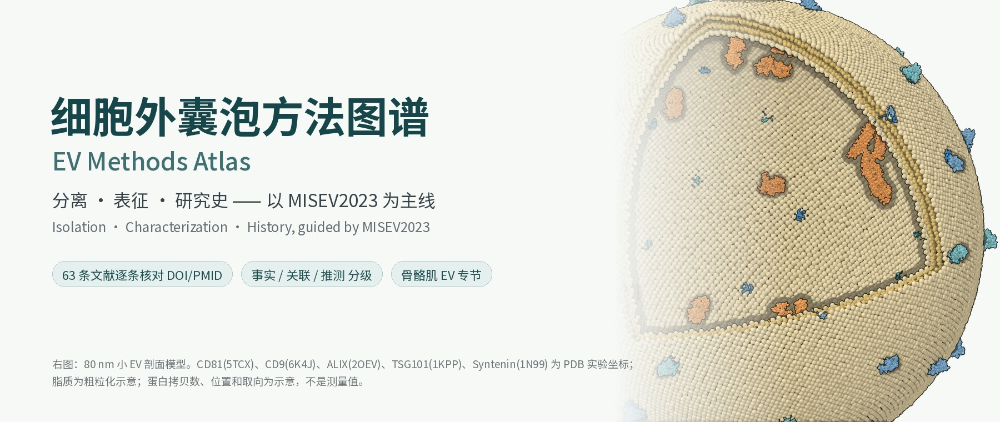
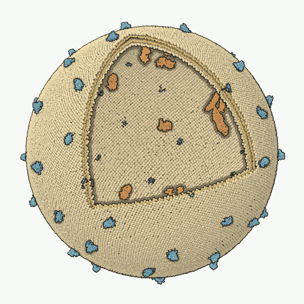
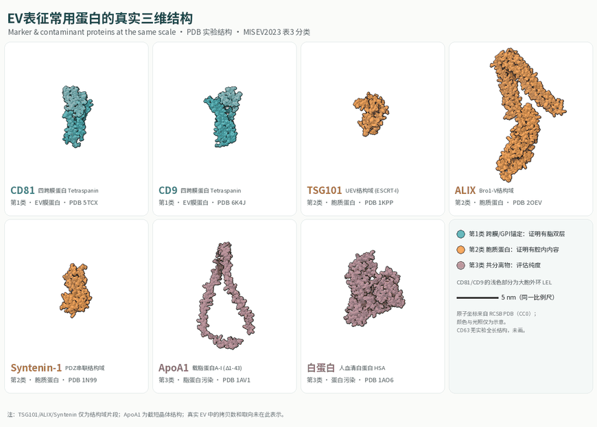
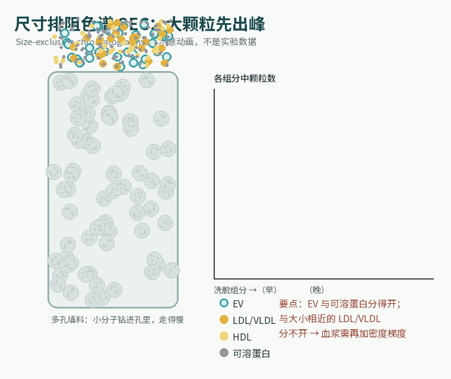
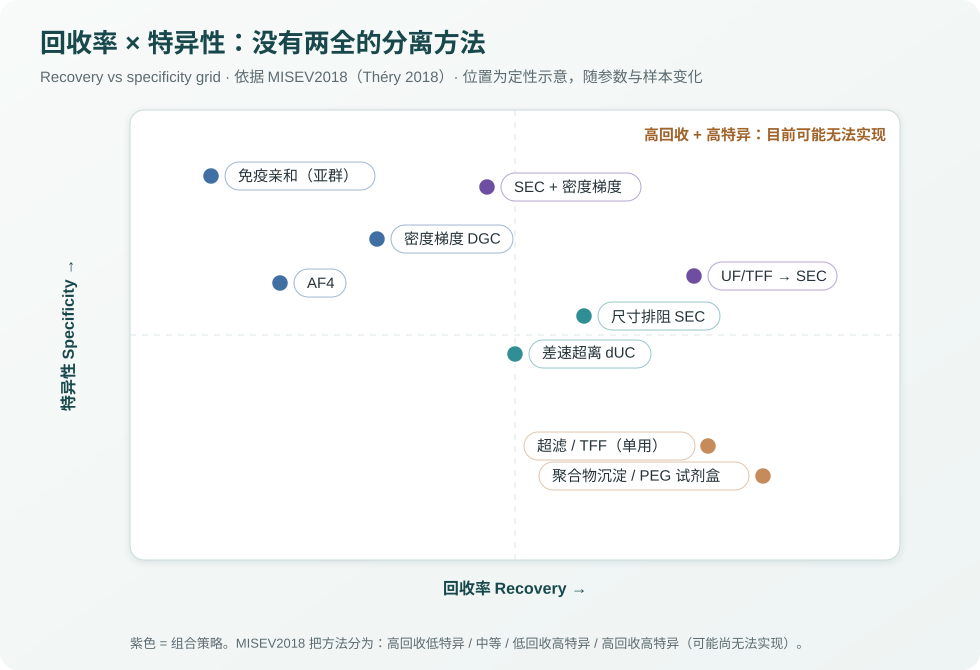
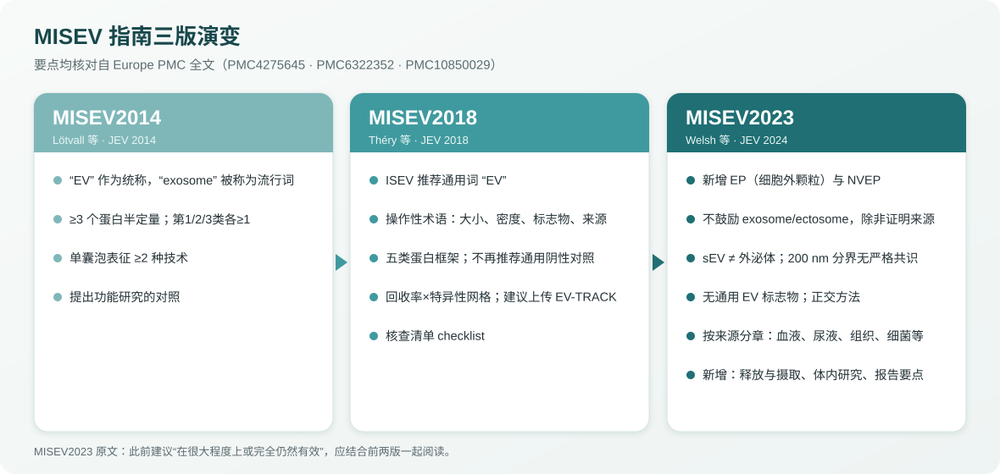
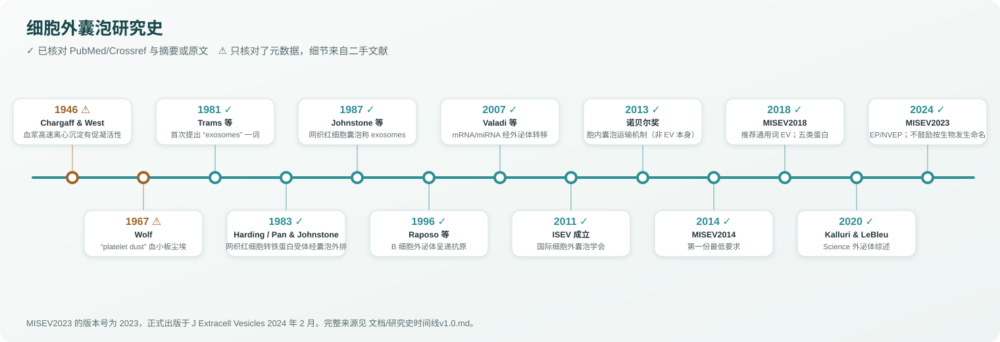
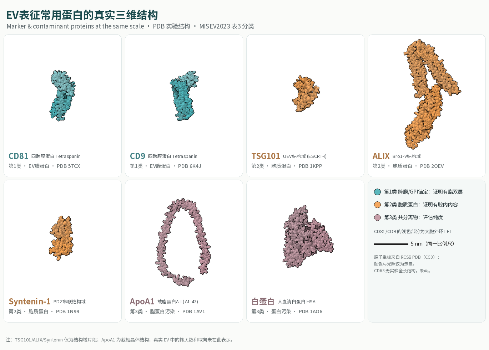

<p align="center">
  
</p>

<h1 align="center">细胞外囊泡方法图谱 · EV Methods Atlas</h1>

<p align="center">
  <strong>把 EV 的分离、表征和研究史，整理成一张可核对的中文地图。</strong><br>
  A Chinese-first, citation-checked atlas of extracellular vesicle methods, guided by MISEV2023.
</p>

<p align="center">
  面向临床医生、研究生和刚进实验室的科研人员：MISEV 三版指南对比、8 类分离方法、表征与报告标准、研究史，外加骨骼肌组织 EV 专节。<br>
  For clinicians, students and new bench researchers: MISEV2014→2018→2023, isolation and characterization methods, reporting standards, history, and a skeletal-muscle EV section.
</p>

<p align="center">
  <a href="README.md">简体中文</a> · <a href="文档/英文说明v1.0.md">English</a>
</p>

<p align="center">
  <a href="https://github.com/TUANZIDING/ev-methods-atlas/actions"></a>
  <a href="LICENSE"></a>
  
  
</p>

<p align="center">
  <code>MISEV2023 主线</code> · <code>分离方法对比表</code> · <code>PDB 真实结构 3D 渲染</code> · <code>旋转动图</code> · <code>RIS / BibTeX</code>
</p>

<p align="center">
  <a href="#use-cases">使用场景</a> ｜ <a href="#showcase">图谱一览</a> ｜ <a href="#quick-start">快速开始</a> ｜ <a href="#evidence">证据规则</a> ｜ <a href="#capabilities">内容状态</a> ｜ <a href="#license">许可</a>
</p>

<p align="center"><sub>主图为本仓库用代码渲染的模型：蛋白原子坐标来自 RCSB PDB 实验结构，脂质为粗粒化示意，拷贝数与取向为示意。没有使用 AI 生成图像。本仓库是学习笔记，不是 ISEV 官方文件。</sub></p>

---

<a id="use-cases"></a>

## 从你的问题进入 · Use cases

| 你想做什么 | 可以怎样开始 |
| --- | --- |
| 弄清楚该写「外泌体」还是「EV」 | [综述 §1.2 术语](文档/综述v1.0.md#12-术语从外泌体到ev再到epnvep) · [MISEV 三版演变图](文档/主图/MISEV演变v1.0.svg) |
| 给血浆、尿液、细胞上清或组织选分离方法 | [分离方法对比表](文档/分离方法对比v1.0.csv) · [综述 §2](文档/综述v1.0.md#2-分离方法isolation--separation) |
| 准备投稿前核对表征是否达标 | [综述 §1.3 五类蛋白](文档/综述v1.0.md#13-蛋白表征五类蛋白框架的沿革) · [§3 表征](文档/综述v1.0.md#3-表征与检测characterization) · [§6 最小方案](文档/综述v1.0.md#6-推荐的最小实验方案模板经验) |
| 做骨骼肌或肌组织来源 EV | [综述 §2.4 骨骼肌专节](文档/综述v1.0.md#24-骨骼肌--肌组织来源-ev-的分离要点) · [流程图](文档/主图/骨骼肌EV流程v1.0.svg) |
| 讲课或写综述引用研究史 | [研究史时间线](文档/研究史时间线v1.0.md) · [参考文献 BibTeX](文档/参考文献/参考文献v1.0.bib) · [RIS](文档/参考文献/参考文献v1.0.ris) |
| 只想下载一份能打印的 | [综述 PDF（14 页）](文档/综述v1.0.pdf) |

<a id="showcase"></a>

## 图谱一览 · Showcase

| 一个小 EV 的剖面（旋转） | EV 表征常用蛋白（同一比例尺） |
| --- | --- |
|  |  |
| CD81 (5TCX)、CD9 (6K4J) 嵌在膜上；ALIX (2OEV)、TSG101 (1KPP)、Syntenin (1N99) 在腔内 | 按 MISEV2023 表 3 分类着色：第 1 类膜蛋白、第 2 类胞质蛋白、第 3 类污染物 |

| SEC 为什么分不开脂蛋白（动画） | 回收率 × 特异性 |
| --- | --- |
|  |  |
| 示意动画，不是实验数据；逻辑依据 Böing 2014、Karimi 2018 | 依据 MISEV2018 的四象限；位置为定性示意 |

<p align="center">
  
</p>

<p align="center">
  
</p>

<p align="center">
  
</p>

### 三条最容易踩的坑

1. **「外泌体」一词最早来自 Trams 1981**，不是 Johnstone 1987；MISEV2023 不鼓励在没有生物发生证据时使用「exosome」，并明确 sEV ≠ 外泌体。
2. **calnexin、GM130 在 MISEV2023 属于第 4 类**（其他胞内区室），不是硬性「阴性标志物」；纯度要看第 3 类：载脂蛋白、白蛋白。
3. **2013 年诺贝尔奖奖的是胞内囊泡运输机制**（Rothman、Schekman、Südhof），不是 EV 研究本身。

<a id="quick-start"></a>

## 先用起来 · Quick start

**只想读：** 打开 [综述v1.0.md](文档/综述v1.0.md) 或下载 [PDF](文档/综述v1.0.pdf)。对比表是 UTF-8 CSV，可直接用 Excel / Numbers 打开。

**导入文献库：** 把 [参考文献v1.0.ris](文档/参考文献/参考文献v1.0.ris) 拖进 EndNote / Zotero，或在 LaTeX 中使用 [参考文献v1.0.bib](文档/参考文献/参考文献v1.0.bib)。每条都带 DOI 与 PMID。

**重新生成图和文档：**

```sh
git clone https://github.com/TUANZIDING/ev-methods-atlas.git
cd ev-methods-atlas
pip install numpy scipy pillow weasyprint      # weasyprint 只用于 PDF
# 中文字体：把 Noto Sans SC / Noto Serif SC（Google Fonts，OFL）放到 ~/.fonts/
python3 示例/标志蛋白图集v1.0.py 文档/主图      # 首次运行会从 RCSB 下载 PDB 文件
python3 示例/EV剖面模型v1.0.py 文档/主图        # 约 3–5 分钟
python3 示例/SEC动画v1.0.py 文档/主图
python3 示例/示意图v1.0.py 文档/主图
python3 示例/构建综述v1.0.py                    # 由 文档/综述源稿v1.0.md 重建编号文献、BibTeX、RIS、CSV、PDF
python3 验证/项目检查v1.0.py
```

<a id="evidence"></a>

## 证据规则 · Evidence rules

| 标签 | 含义 |
| --- | --- |
| 【事实】 | 原文直接陈述，已读原文或摘要；只读了摘要的注明「据摘要」 |
| 【关联】 | 某项研究中的比较或相关结果，不代表普遍成立 |
| 【经验/推测】 | 领域通行做法或作者推论，尚无专门验证，使用前请自行核实 |
| ✅ / ⚠️ | 时间线中：已核对元数据与摘要 / 只核对了元数据，细节来自二手文献 |

所有文献于 2026-10-31 在 Crossref 与 PubMed 逐条核对 DOI、PMID、卷期页；MISEV2014/2018/2023 三篇指南的相关章节读自 Europe PMC 全文（PMC4275645、PMC6322352、PMC10850029）。图像来源与许可见 [素材说明](文档/素材说明v1.0.md)。

<a id="capabilities"></a>

## 当前包含什么 · Capability status

| 状态 | 内容 | 实际边界 |
| --- | --- | --- |
| 已整理 | 中文综述（MISEV 主线、分离、表征、研究史、常见坑、最小方案） | 定性比较；具体参数需按自己样本预实验 |
| 已核对 | 63 条参考文献的 DOI/PMID 与元数据 | 多数文献只读了摘要；Chargaff 1946、Wolf 1967 原文未读 |
| 可运行 | 分子渲染、EV 剖面模型、SEC 动画、示意图、综述构建脚本 | 渲染需联网下载 PDB；字体需自行安装 |
| 示意 | EV 剖面模型中的蛋白拷贝数、位置、取向，SEC 动画中的颗粒行为 | 不是测量值，不能当数据引用 |
| 不包含 | 付费全文 PDF、未发表数据、个人信息 | 全文请从出版社或 PubMed Central 获取 |

## 参与共创 · Contribute

发现事实错误、过时结论或更好的文献，欢迎开 Issue：请附 DOI 或 PMID，并说明是原文哪一处。

<a id="license"></a>

## 许可 · License

本仓库的文字、代码和自绘图以 [MIT](LICENSE) 发布。蛋白原子坐标来自 [RCSB PDB](https://www.rcsb.org/)（数据为 CC0 公共领域），各结构的原始论文见 [素材说明](文档/素材说明v1.0.md)。引用的指南与论文版权归原作者和出版社所有。

<sub>本仓库内容仅用于学习与研究，不构成临床或实验操作建议。</sub>
