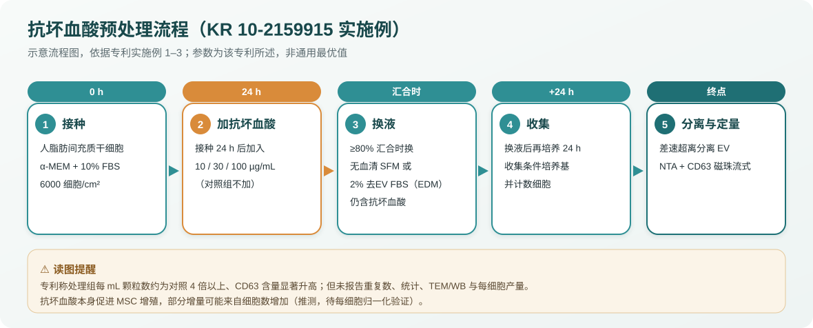
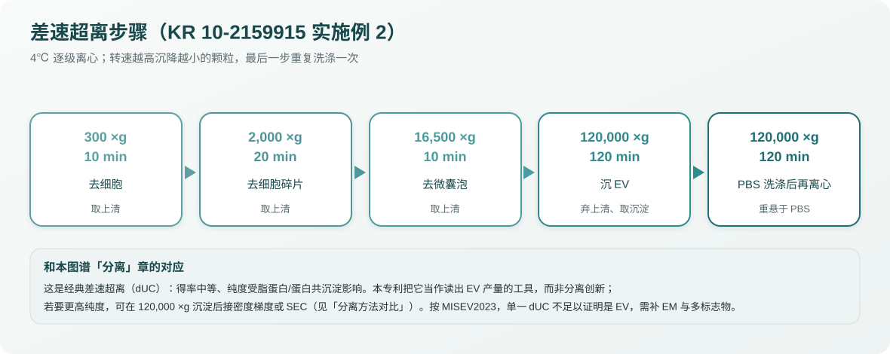

# 专利解读：抗坏血酸促进 EV 生成（KR 10-2159915 B1）v0.1

> 这是一篇**自撰的中文解读笔记**，不是专利译文。目的是帮读者快速判断「这件专利讲了什么、证据有多硬、和 MISEV2023 的差距在哪」。原文（韩文）请看下方链接；本仓库不放原文 PDF 与原图。
> 本文不是法律意见。专利范围以官方公告文本为准。

## 1. 书目信息【事实】

| 项目 | 内容 |
| --- | --- |
| 发明名称 | 엑소좀 및/또는 세포외 소포체의 생성 촉진 방법（促进外泌体和/或细胞外囊泡生成的方法） |
| 公开号 | KR 10-2159915 B1（登记专利公报 B1） |
| 专利权人 | 주식회사 엑소코바이오 ExoCoBio Inc.（首尔） |
| 发明人 | 조병성、하대현 |
| 申请号 / 申请日 | 10-2020-0065539 / 2020-05-31 |
| 优先权 | KR 10-2019-0114456（2019-09-18） |
| 登记日 / 公告日 | 2020-09-19 / 2020-09-24 |
| 权利要求数 | 9 项 |
| 法律状态 | Active（2026 年已缴至第 7 年年费，据 Google Patents） |
| 同族 | PCT/KR2020/007798（WO 2021/054576 A1）；US 17/465,022（US 2021/0395694 A1，Google Patents 标为 Abandoned）；Google Patents 的同族列表中未见 CN 同族 |
| IPC/CPC | C12N 5/00、5/0775；C12N 2500/38（维生素）、2500/90（无血清培养基） |

链接见 [专利索引](patents-index-v0.1.md)。

## 2. 核心主张【事实】

一句话：**把动物来源细胞养在含「抗坏血酸」的培养基里，可以提高每 mL（或每份培养液）分泌的外泌体/EV 数量。**

权利要求结构（据公告文本）：
- **权 1（独立，方法）**：动物来源细胞在**含抗坏血酸**的培养基中培养，以促进 EV 生成。
- 权 2–4：追加培养步骤——配**含 FBS**、或**去 EV 的 FBS**、或**无血清**培养基。
- 权 5–6：抗坏血酸浓度 **1–300 µg/mL**，优选 **10–100 µg/mL**。
- **权 7（独立，产品）**：一种**含抗坏血酸的促 EV 生成培养基**。
- 权 8–9：该培养基中抗坏血酸浓度同样 1–300、优选 10–100 µg/mL。

> ⚠️ **保护范围提醒【事实+经验】**：说明书把「抗坏血酸」展开为一长串衍生物（AA-2G、AA-2P、AA-2S、抗坏血酸磷酸镁、抗坏血酸棕榈酸酯、抗坏血酸钠/钙、乙基抗坏血酸等），但**授权的权利要求只写了「아스코르브산（ascorbic acid，抗坏血酸）」**，没有把「类似物或衍生物」写进权项。因此就本件而言，专利范围实际落在抗坏血酸本身；说明书里的衍生物更多是支持与布局，不能想当然地认为都受本专利保护。真正范围以权项解释为准。

## 3. 实验流程（实施例）【事实，据原文实施例 1–3】

细胞与接种：人脂肪来源间充质干细胞（hADSC），α-MEM + 10% FBS + 双抗，6 孔板 6,000 细胞/cm²，37℃、5% CO₂。

加药：接种 24 h 后，处理组分别加 **10 / 30 / 100 µg/mL** 抗坏血酸，对照组不加。

换液：≥80% 汇合时，换成**无血清 SFM**，或**去 EV 的 2% FBS 培养基（EDM）**，处理组该培养基中仍含对应浓度抗坏血酸。

收集：换液后再培养 **24 h**，收集条件培养基；收完用细胞计数器数细胞。

分离（差速超离，4℃）：300×g 10 min → 2,000×g 20 min → 16,500×g 10 min → 120,000×g 120 min，弃上清取沉淀，PBS 洗，再 120,000×g 120 min，重悬于 PBS。

表征与定量：
- **NTA**（Malvern）测粒径与浓度：处理组粒径分布更均一。
- 每 mL 颗粒数：处理组较对照**约 4 倍以上**。
- **CD63 磁珠流式**：EV 与 Exosome-Human CD63 捕获试剂孵育过夜，PE 抗人 CD63 染色测 MFI；用已知浓度 CD63 蛋白做标准曲线（线性 R²≥0.99）换算含量，处理组 CD63 含量显著升高。

## 4. 结果【关联，非普遍结论】

在该专利的 hADSC 体系、上述一套参数下：
- 抗坏血酸处理使**每 mL 条件培养基的 EV 颗粒数**和 **CD63 含量**都升高；
- 粒径分布更均一；
- 图 2、图 3 只画了 0、30、100 µg/mL 三组（10 µg/mL 组未作图），条形呈 0 < 30 < 100 的剂量趋势。按条形目测，100 µg/mL 组约为对照的 5 倍，30 µg/mL 组约 3 倍；正文概括为「约 4 倍以上」。

这些是**该专利内部的比较结果**，不能直接外推到其他细胞、其他培养基或其他分离方法。

## 5. 按 MISEV2023 审视（证据强度）【经验/推测】

把这件专利当**科研证据**来读时，和 MISEV2023 的要求相比有这些缺口：

- **统计与重复**：未报告 n、未报告统计检验或误差线。单组条形图不足以支撑「显著」。
- **表征不完整**：只有 NTA 与 CD63 流式；**没有 TEM/cryo-EM 形态、没有 Western blot 多标志物、没有阴性/污染标志（载脂蛋白、白蛋白）**。按 MISEV2023，证明「是 EV」需要正交方法与多类标志物，CD63 单指标不够。
- **「每 mL 增加」≠「每细胞增加」**：抗坏血酸本身是 MSC 常用促增殖/促胶原的添加剂，会让细胞长得更多。实施例数了细胞却**没有报告每细胞产量**，所以观察到的 mL 级增量**可能部分来自细胞数增加**（推测，需每细胞归一化才能区分「分泌更多」还是「细胞更多」）。
- **货物/功能可能改变**：抗坏血酸具还原/抗氧化活性、促胶原分泌，可能改变 EV 的蛋白与 miRNA 货物乃至功能（**推测**）。专利关注产量，未评估货物与功能是否等价。
- **证据级别**：专利数据**未经同行评议**，与期刊论文不是一个证据层级。

一句话给读者：**作为「提高产量的一个可尝试手段」有参考价值；作为「抗坏血酸让 EV 变多」的科学结论，证据还不足，自己做时务必补每细胞归一化、形态与多标志物表征。**

## 6. 对研究者的可能用处【经验/推测】

- 对放射性肌损伤等需要**放大 MSC-EV 产量**做体内实验的研究，抗坏血酸预处理是低成本、易上手的一招，但要先在自己体系里验证是否真的提高**每细胞产量**，并确认不改变你关心的货物（如 myomiR、修复相关 miRNA）。
- 和「上游产量提升策略对比」一章一起看：缺氧、3D/生物反应器等策略的放大倍数与机制各不同，可组合但要分别对照。

## 来源

- 专利公告文本（韩文），本项目 `sources/`（不随仓库发布）。
- 书目与法律状态、同族：Google Patents `KR102159915B1`（2026-10-31 核对）。
