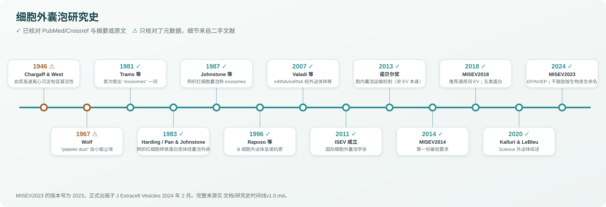

# 细胞外囊泡研究史时间线 v1.0

> 状态：✅ 已核对 PubMed/Crossref 元数据（年份、期刊、卷页）并读过摘要；⚠️ 只核对了元数据，具体说法来自二手文献，原文全文未读。

| 年份 | 事件 | 文献 | 状态与备注 |
|---|---|---|---|
| 1946 | Chargaff & West 发现血浆经高速离心后的沉淀具有促凝（凝血活酶）活性，被视为最早的 EV 相关观察 | Chargaff E, West R. J Biol Chem 1946;166:189–197 [49] | ⚠️ 元数据已核对（PMID 20273687，无摘要）；「高速离心沉淀促凝」的描述来自后来的综述，原文未读 |
| 1967 | Wolf 用电镜观察到血小板来源、富含磷脂的小颗粒，称为「platelet dust（血小板尘埃）」 | Wolf P. Br J Haematol 1967;13:269–288 [50] | ⚠️ 元数据已核对；「platelet dust」一词广泛归于此文，原文全文未读 |
| 1981 | Trams 等提出把细胞脱落的、带 5'-核苷酸酶活性的囊泡称为「exosomes」——**这是「exosome」一词首次用于 EV**，早于 Johnstone 1987 | Trams EG et al. Biochim Biophys Acta 1981;645:63–70 [51] | ✅ 摘要原文：「it is proposed that they be referred to as exosomes」；所指囊泡平均 500–1000 nm，与今天所说的外泌体并不相同 |
| 1983 | 两组几乎同时报道网织红细胞成熟中转铁蛋白受体经囊泡排出：Harding、Heuser、Stahl（大鼠网织红细胞，J Cell Biol）与 Pan & Johnstone（绵羊网织红细胞，Cell） | [52,53] | ✅ 元数据已核对 |
| 1985 | Pan 等用免疫电镜追踪转铁蛋白受体：受体进入多泡体（MVE），其内约 50 nm 的小体在 MVE 与质膜融合后被释放——内体/多泡体途径的形态学证据 | Pan BT et al. J Cell Biol 1985;101:942–948 [54] | ✅ 摘要已读 |
| 1987 | Johnstone 等在标题中把网织红细胞释放的囊泡称为「exosomes」，100,000 g 离心 90 min 收集 | Johnstone RM et al. J Biol Chem 1987;262:9412–9420 [55] | ✅ 摘要已读；常被称为「命名外泌体」，准确说法是「把 exosome 一词用于网织红细胞来源的内体途径囊泡并使之流行」，首次使用见 1981 |
| 1996 | Raposo 等：B 淋巴母细胞的 MIIC 限制膜与质膜融合，释放带 MHC II 的「exosomes」，可呈递抗原刺激 T 细胞 | Raposo G et al. J Exp Med 1996;183:1161–1172 [56] | ✅ 摘要已读 |
| 1998 | Zitvogel 等：树突细胞来源外泌体作为无细胞疫苗清除小鼠已建立的肿瘤 | Nat Med 1998;4:594–600 [57] | ✅ 元数据已核对（补充条目） |
| 2007 | Valadi 等：肥大细胞（MC/9、HMC-1 及原代）外泌体含约 1300 个基因的 mRNA 和 miRNA，可转移到其他细胞并被翻译，提出「exosomal shuttle RNA」 | Nat Cell Biol 2007;9:654–659 [58] | ✅ 摘要已读 |
| 2008 | Skog 等：胶质母细胞瘤微囊泡携带 RNA 和蛋白，可作诊断生物标志物 | Nat Cell Biol 2008;10:1470–1476 [59] | ✅ 元数据已核对（补充条目） |
| 2011 | ISEV 成立 | MISEV2023 原文：「Founded in 2011」[1] | ✅ 以 MISEV2023 原文为据 |
| 2013 | 诺贝尔生理学或医学奖授予 Rothman、Schekman、Südhof，表彰「调控囊泡运输的机制」——**这是细胞内囊泡运输，并非 EV 本身的奖项** | Nobel Assembly 新闻稿 2013-10-07 [60] | ✅ 官网新闻稿已读 |
| 2013 | Gould & Raposo：「As we wait」，讨论 EV 命名不完善的应对 | J Extracell Vesicles 2013;2:20389 [61] | ✅（补充条目） |
| 2014 | MISEV2014 | [9] | ✅ 全文相关章节已读 |
| 2017 | EV-TRACK 知识库 | Nat Methods 2017 [10] | ✅ |
| 2018 | MISEV2018；AF4 发现 exomere（约 35 nm 非膜性纳米颗粒）[26] | [2] | ✅ |
| 2019 | Jeppesen「Reassessment of Exosome Composition」 | Cell 2019 [18] | ✅ |
| 2020 | Kalluri & LeBleu「The biology, function, and biomedical applications of exosomes」 | Science 2020;367:eaau6977 [62] | ✅ 元数据已核对；注意这篇综述沿用「exosome」一词，与 ISEV 术语建议不同 |
| 2020 | MIFlowCyt-EV | [12] | ✅ |
| 2023 | MIBlood-EV | [5] | ✅ |
| 2024 | MISEV2023 正式出版（J Extracell Vesicles 2024 年 2 月） | [1] | ✅ 全文相关章节已读 |

文中编号对应 [综述v1.0](综述v1.0.md#参考文献) 的参考文献列表。
