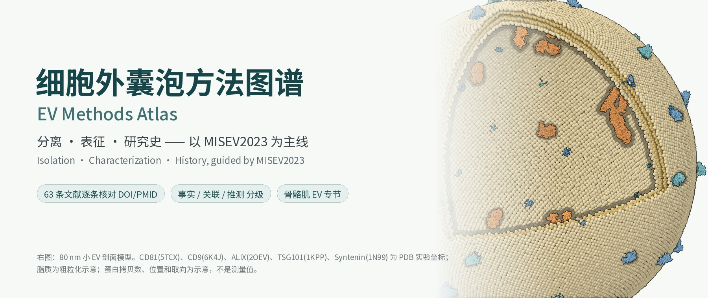

<p align="center"></p>

# EV Methods Atlas · English guide

[简体中文](../README.md) · English

A Chinese-first, citation-checked study atlas of extracellular vesicle (EV) methods, organised around **MISEV2023** (Welsh et al., *J Extracell Vesicles* 2024;13:e12404, doi:10.1002/jev2.12404).

## What is inside

| File | Content |
| --- | --- |
| [综述v1.0.md](综述v1.0.md) / [PDF](综述v1.0.pdf) | Review (Chinese with English key terms): MISEV2014→2018→2023, isolation, characterization, history, pitfalls, minimal protocol |
| [分离方法对比v1.0.csv](分离方法对比v1.0.csv) | Isolation methods: principle, yield, purity, throughput, cost, sample types, combinations, key references |
| [粒径计数方法v1.0.csv](粒径计数方法v1.0.csv) | NTA, TRPS, nano-flow cytometry, DLS |
| [上游产量提升v0.1.md](上游产量提升v0.1.md) | Upstream yield enhancement: comparison table + KR 10-2159915 patent note (ascorbic acid, ExoCoBio) + [patents index](patents-index-v0.1.md) |
| [研究史时间线v1.0.md](研究史时间线v1.0.md) / [CSV](研究史时间线v1.0.csv) | Timeline 1946–2024 with verification status |
| [参考文献/](参考文献/) | 63 references as BibTeX, RIS and JSON metadata, each with DOI and PMID |
| [主图/](主图/) | Code-rendered figures and GIFs |

## Key corrections found while verifying

1. The word "exosomes" was first proposed for EVs by **Trams et al. 1981** (BBA 645:63), six years before Johnstone et al. 1987.
2. In MISEV2023 Table 3, calnexin and GM130 are **category 4** (other intracellular compartments), not mandatory negative markers; purity is assessed with category 3 (lipoproteins, albumin).
3. The 2013 Nobel Prize (Rothman, Schekman, Südhof) honoured **intracellular vesicle traffic**, not EV biology itself.
4. MISEV2023 introduces EP / NVEP terms, discourages biogenesis-based names (exosome, ectosome) without proof of origin, and states that sEV is not a synonym of exosome.

<a id="quick-start"></a>
## Quick start

```sh
pip install numpy scipy pillow weasyprint
# fonts: Noto Sans SC / Noto Serif SC (OFL) in ~/.fonts/
python3 示例/标志蛋白图集v1.0.py 文档/主图
python3 示例/EV剖面模型v1.0.py 文档/主图
python3 示例/SEC动画v1.0.py 文档/主图
python3 示例/示意图v1.0.py 文档/主图
python3 示例/构建综述v1.0.py
python3 验证/项目检查v1.0.py
```

## Figures are rendered, not generated

Protein atoms come from experimental RCSB PDB entries (CC0): CD81 5TCX, CD9 6K4J, TSG101 UEV 1KPP, ALIX 2OEV, syntenin-1 1N99, ApoA1 1AV1, serum albumin 1AO6. A small numpy z-buffer sphere renderer with Goodsell-style outlines draws them. Lipids in the EV model are coarse illustrative beads; copy numbers and orientations are illustrative. No AI image generation was used.

## Evidence labels

【事实】 stated in the source (abstract-only reading is marked) · 【关联】 a comparison in specific studies · 【经验/推测】 common practice or inference, not validated.

License: MIT for text, code and figures of this repository. Study notes only; not an ISEV document; not clinical or laboratory advice.
